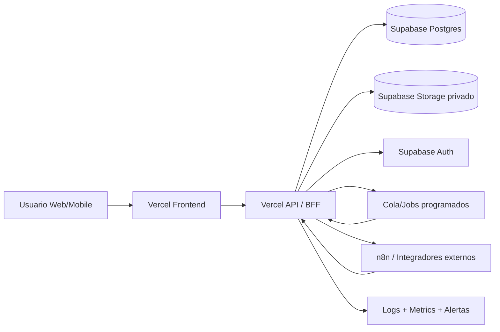

# Propuesta de Implantacion: Arquitectura Vercel + Supabase Gobernada

- Version: `1.0.0`
- Objetivo: estandarizar un patron multi-proyecto para desplegar modulos de comunicaciones/chat y gestor documental con gobierno tecnico desde el dia 1.

## 1) Principios de arquitectura

1. `Seguridad por defecto`: nada publico por accidente.
2. `Gobierno por capas`: identidad, autorizacion, datos, secretos, auditoria.
3. `Trazabilidad completa`: cada accion critica deja evidencia auditable.
4. `Plantilla reusable`: mismos bloques para todos los desarrollos.
5. `Entornos aislados`: `dev`, `staging`, `prod` con credenciales separadas.

## 2) Topologia de referencia (recomendada)

## Variante transicional (si ya existe backend Express)

1. Mantener backend actual mientras frontend migra a Vercel.
2. Encapsular APIs en rutas estables versionadas (`/api/v1`).
3. Planificar migracion gradual a funciones Vercel o servicio dedicado.

## 3) Stack objetivo por proyecto

- `Frontend`: Next.js o app React compilada en Vercel.
- `BFF/API`: Vercel Functions (Node) para endpoints de dominio.
- `Base de datos`: Supabase Postgres.
- `Auth`: Supabase Auth + claims/metadata de organizacion/rol.
- `Storage`: bucket privado por dominio (ej. `documentos`).
- `Realtime` (opcional): Supabase Realtime para chat push.
- `Workflow`: n8n (webhooks inbound/outbound) cuando aplique.

## 4) Gobierno tecnico obligatorio

## 4.1 Identidad y autorizacion

1. Resolver rol efectivo en backend (nunca confiar en frontend).
2. Soportar modelo `rol + mandato` para terceros/delegados.
3. Definir matriz de permisos comun (`canUploadDocs`, `canValidateDocs`, `canSendCommunications`, etc.).

## 4.2 Data governance

1. Activar RLS en tablas sensibles.
2. Politicas por `tenant` y `contrato_id`.
3. Service role solo en backend seguro (jamas en cliente).
4. Migraciones SQL versionadas y revisadas por PR.

## 4.3 Storage governance

1. Buckets privados por dominio.
2. Acceso solo por signed URLs de corta vida.
3. Paths normalizados: `{tenant}/{contrato}/{tipo}/{uuid.ext}`.
4. Politica de retencion y purgado controlado.

## 4.4 Auditoria y evidencia

1. Tabla de eventos para acciones criticas.
2. Hash de contenido para documentos/comunicaciones.
3. Sellado temporal (QTSP o proveedor equivalente) donde aplique.
4. Encadenado de hash recomendado para cadena de custodia.

## 4.5 Secretos y cumplimiento

1. Secretos en Vercel Project Env + rotacion trimestral.
2. Prohibido hardcode de keys en repo.
3. Clasificacion de datos (`publico`, `interno`, `sensible`).
4. Encriptacion en transito y en reposo.

## 5) Diseno estandar para modulos Comunicaciones/Chat/Documentos

## Comunicaciones + Chat

- Tablas base: `comunicaciones`, `mensajes`, `eventos`, `sellos_tiempo`.
- Endpoints base: crear/listar/responder/enviar/marcar + chat + relevantes.
- Integraciones base: webhook saliente + endpoint inbound.

## Gestor Documental

- Tablas base: `inventario_expediente`, `archivos`, `eventos`, `sellos_tiempo`.
- Endpoints base: listar, subir, validar, rechazar, reemplazar, preview, descargar.
- Storage base: bucket privado + signed URL + logging de acceso.

## 6) Estrategia de entornos

| Entorno | Vercel | Supabase | Uso |
|---|---|---|---|
| `dev` | proyecto desarrollo | proyecto desarrollo | trabajo diario |
| `staging` | preview protegido | proyecto staging | QA/UAT |
| `prod` | proyecto produccion | proyecto produccion | clientes reales |

Reglas:

1. Nunca compartir DB de `prod` con otros entornos.
2. Deploy a `prod` solo desde rama protegida.
3. Migrations aplicadas primero en `staging`.

## 7) Pipeline de despliegue gobernado

1. PR con cambios de codigo + migraciones + tests.
2. Preview deploy automatico en Vercel.
3. Validaciones minimas:
   - tests unitarios,
   - tests de autorizacion,
   - smoke de API,
   - lint/typecheck.
4. Aprobacion tecnica + aprobacion de datos (si hay DDL).
5. Release a produccion con checklist de rollback.

## 8) Observabilidad estandar

- Logs estructurados JSON con `request_id`, `user_id`, `contrato_id`.
- Dashboards minimos:
  - salud API,
  - errores 4xx/5xx,
  - latencia p95,
  - uso storage,
  - tasa de fallos de integraciones.
- Alertas:
  - picos de 5xx,
  - fallo en proveedor de sellado,
  - errores de signed URL,
  - drift de migraciones.

## 9) Roadmap de implantacion para otros desarrollos

## Onda 1: Foundation (1-2 semanas)

1. Crear proyecto Vercel + Supabase por entorno.
2. Configurar Auth, tablas base, RLS y bucket privado.
3. Montar API skeleton con middleware de autorizacion.

## Onda 2: Core modules (2-4 semanas)

1. Implementar Comunicaciones + Chat segun PRD.
2. Implementar Gestor Documental segun PRD.
3. Integrar timeline de eventos y evidencias.

## Onda 3: Hardening (1-2 semanas)

1. Integrar webhook inbound/outbound.
2. Completar observabilidad y alertas.
3. Ejecutar pruebas de carga y seguridad.

## Onda 4: Escalado portfolio (continuo)

1. Extraer librerias compartidas (`permissions`, `events`, `storage`, `audit`).
2. Publicar plantilla interna para nuevos repos.
3. Medir KPIs cross-proyecto y ajustar baseline.

## 10) Checklist de salida a produccion

1. RLS activo en tablas sensibles.
2. Signed URLs obligatorias para documentos privados.
3. Matriz de permisos validada con test automatizado.
4. Eventos auditables para acciones criticas.
5. Backups y restore testados.
6. Rotacion de secretos documentada.
7. Runbook de incidentes publicado.

## 11) Riesgos y mitigaciones

1. Riesgo: crecimiento descontrolado de variantes entre proyectos.
   Mitigacion: plantilla unica + ADRs obligatorios para desviaciones.
2. Riesgo: permisos inconsistentes por implementaciones ad-hoc.
   Mitigacion: paquete comun de autorizacion reutilizable.
3. Riesgo: deuda operativa en integraciones externas.
   Mitigacion: contrato webhook versionado + reintentos + DLQ.

## 12) Entregables recomendados por nuevo proyecto

1. `PRD_COMUNICACIONES_CHAT.md` adaptado al dominio.
2. `PRD_GESTOR_DOCUMENTAL.md` adaptado al dominio.
3. `DATA_GOVERNANCE.md` (RLS, retencion, clasificacion).
4. `DEPLOY_GOVERNANCE.md` (entornos, pipeline, rollback).
5. `RUNBOOK_OPERACION.md` (incidentes y mantenimiento).
